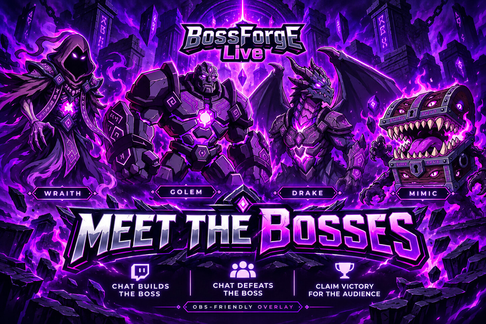
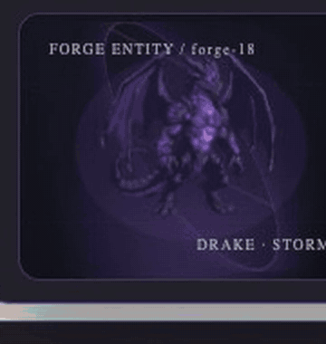
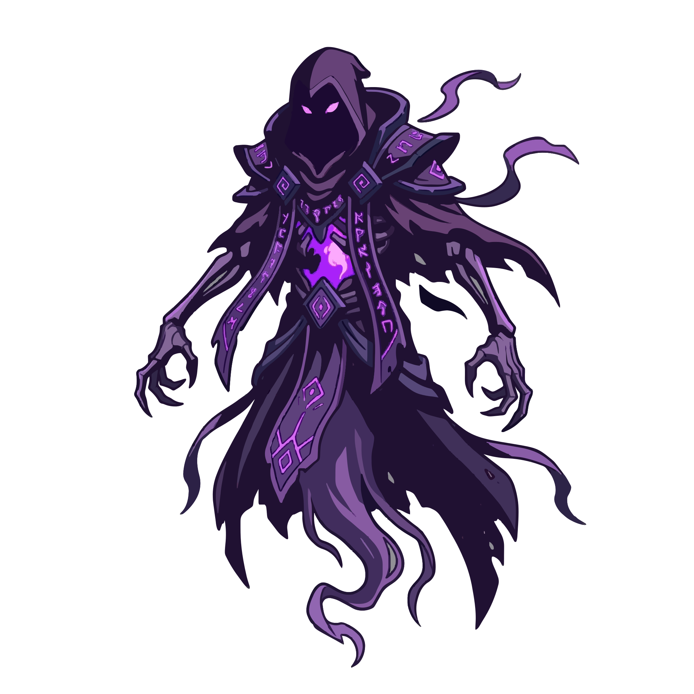
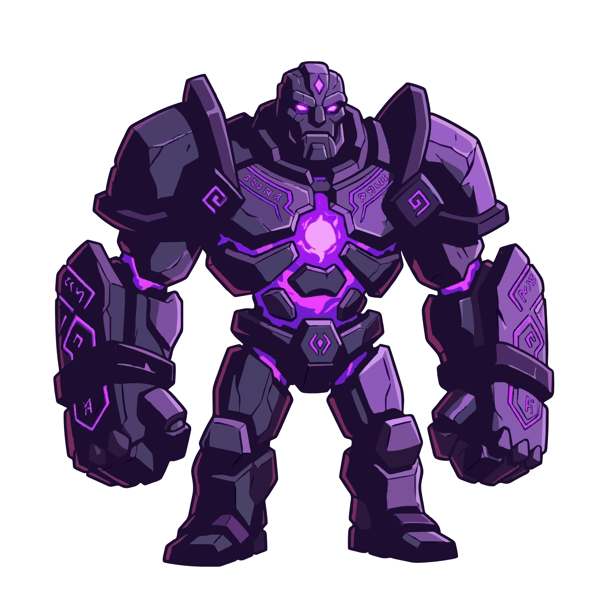
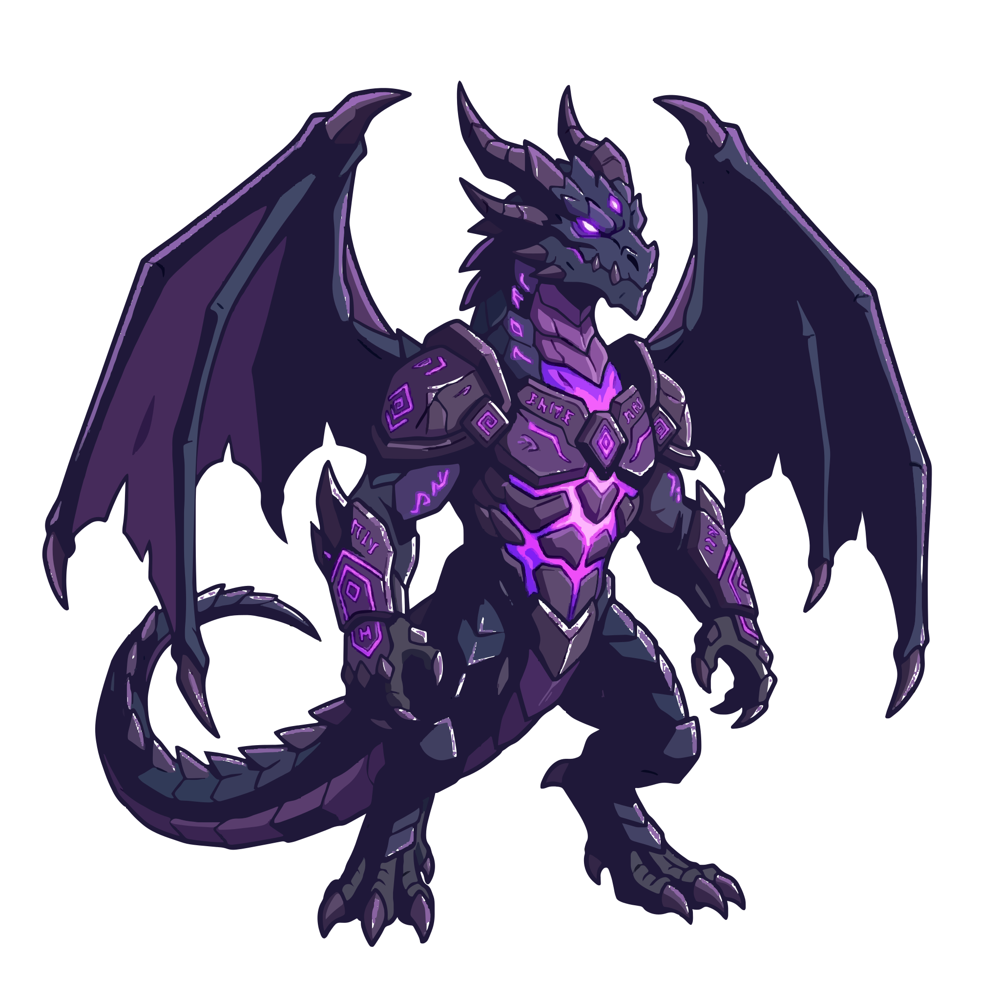
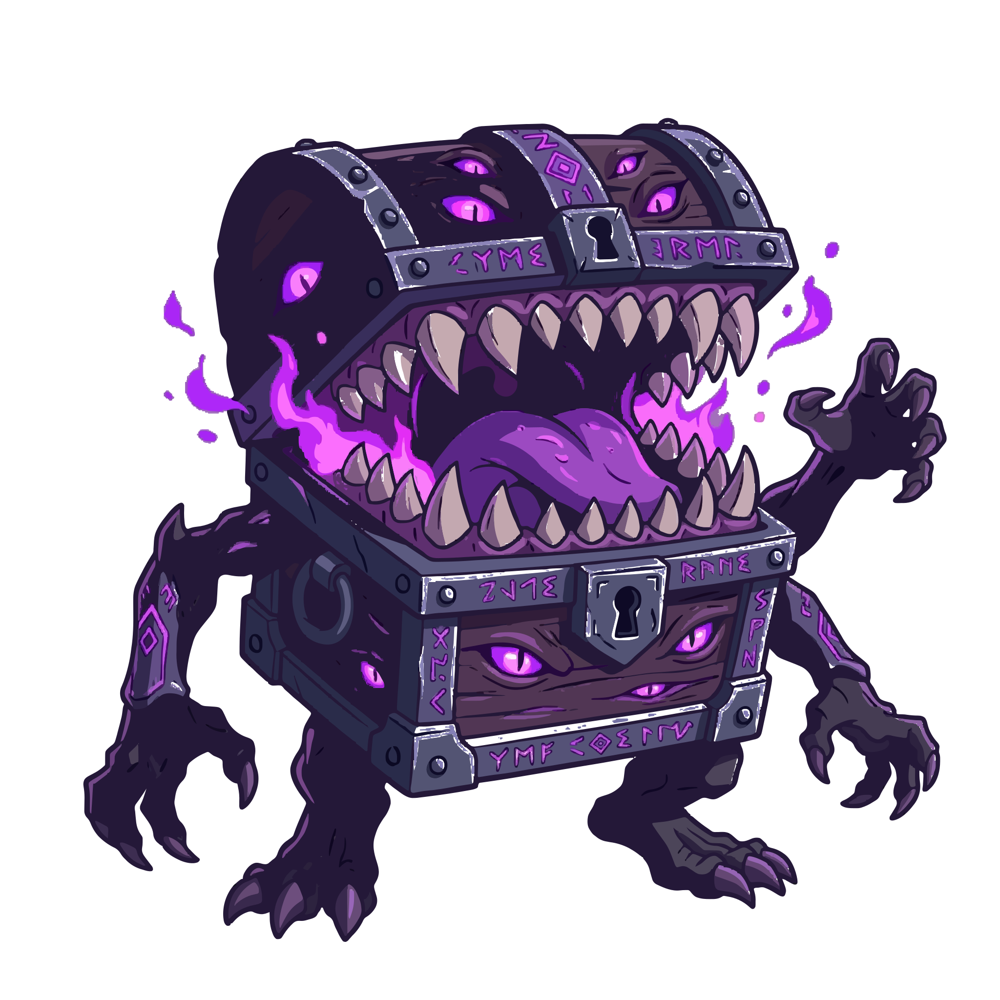

<p align="center">
  
</p>

<h1 align="center">BossForge Live</h1>

<p align="center"><strong>Chat creates the boss. Chat fights the boss. You keep playing.</strong></p>

<p align="center">
  <a href="#how-it-works">How it works</a> ·
  <a href="#meet-the-bosses">Meet the bosses</a> ·
  <a href="#battle-rules">Battle rules</a> ·
  <a href="#obs-browser-source">OBS setup</a> ·
  <a href="#run-locally">Run locally</a> ·
  <a href="#verification-status">Verification</a>
</p>

<p align="center">
  
</p>

<p align="center"><sub>Synthetic, local browser footage from the Boss Motion V1 QA recording. This is not genuine Twitch or native OBS footage.</sub></p>

BossForge Live turns Twitch chat into a cooperative boss encounter that sits
beside the streamer's game as a read-only OBS Browser Source. Viewers shape a
boss, then work together to defeat it—without game hooks, telemetry, or input
control.

## How it works

**Chat Builds → Boss Revealed → Chat Battles → Community Victory**

1. **Chat builds.** Viewers vote on body, element, special, and weakness in four
   timed stages. The server assembles the result after the votes close.
2. **The boss is revealed.** The completed boss and its audience-selected
   weakness become authoritative server state. The streamer explicitly starts
   the battle; reveal alone never starts combat.
3. **Chat battles.** During a 60, 90, or 120-second encounter, viewers send
   bounded `!hit` commands through Twitch chat. The server validates each
   attack and owns HP, timing, replay protection, and terminal outcomes.
4. **The community wins together.** Reduce the boss to zero before the deadline
   for **COMMUNITY VICTORY! BOSS DEFEATED!** If time expires first, the result is
   **BOSS SURVIVED! TRY AGAIN!** A verified disconnect cancels the encounter;
   reconnect never resumes it.

The optional Phaser Arena remains a separate, local game demo. It is not the
Twitch battle and does not read or control the streamer's game.

## Meet the bosses

The four original VecSynIQ characters are bundled as optimized local SVGs.
Their body art is combined with the forged element, special, and weakness.

|                                                         Boss                                                          |                                                        Boss                                                        |
| :-------------------------------------------------------------------------------------------------------------------: | :----------------------------------------------------------------------------------------------------------------: |
| <br><strong>Wraith</strong> | <br><strong>Golem</strong> |
|  <br><strong>Drake</strong>   | <br><strong>Mimic</strong> |

## Audience votes choose the weakness

Each stage accepts the category's configured choices using `!vote
<category> <choice>`, for example `!vote body drake` or `!vote weakness water`.
A viewer can update their ballot while that stage is open. The weakness comes
from accepted audience ballots; it is never silently set to Water. If a weakness
stage receives no valid ballots, BossForge opens one additional bounded voting
window. A second empty window ends safely without revealing a boss or starting
a battle, and the dashboard explains why.

The allowed weakness commands are `water`, `light`, `earth`, and `wind`. The
active overlay instructions use the current authoritative boss weakness and
are hidden whenever its server state is unavailable or stale.

## Battle rules

- `!hit` deals **8 HP**.
- `!hit <selected weakness>` deals **14 HP**. For example, if the revealed
  weakness is Water, `!hit water` gets the weakness bonus.
- A recognized but nonmatching element deals the base **8 HP**; it does not get
  the bonus. Unsupported commands are rejected.
- An accepted hit starts the per-viewer **2-second cooldown**. Duplicate,
  queue, global-rate, and encounter-deadline checks are enforced server-side.
- The owner chooses duration and expected audience band before battle. Starting
  HP is fixed for that encounter:
  - **60 seconds:** low 100 · medium 400 · high 1,000 HP
  - **90 seconds:** low 150 · medium 550 · high 1,500 HP
  - **120 seconds:** low 200 · medium 750 · high 2,000 HP

These are bounded profile settings, not live viewer-count scaling. Only the
server can apply damage or resolve victory, survival, or cancellation.

## OBS Browser Source

Add the local `/overlay` page as an OBS Browser Source beside any game. It
presents the forged boss, battle status, HP, timer, weakness, accepted-hit
aggregate, exact attack instructions, and a clear **LIVE TWITCH** or
**SIMULATED** label. The overlay is read-only: it has no owner controls and no
browser damage route. It does not inspect gameplay or inject game input.

The web app provides a local browser preview at
`http://127.0.0.1:5173/overlay`. Native OBS should use the same loopback URL
while the local app is running. Actual OBS acceptance for the current live
battle HUD and synchronized HP is still incomplete; see [verification status](#verification-status).

## Security and privacy

- Twitch OAuth and EventSub are owner-authorized local integrations; the app
  binds to loopback for development. Twitch mode fails closed on disconnect or
  session invalidation.
- Chat is validated and processed on the server. Replay IDs, cooldown state,
  and process-local viewer pseudonyms stay server-side.
- Browser and OBS recipients receive strict, allowlisted projections. Viewer
  names, IDs, chat text, message IDs, tokens, and cookies are not sent to OBS.
- The overlay is a read-only display. No public damage endpoint or arbitrary
  game integration exists.
- Mock mode is explicit, local, credential-free, and labeled **SIMULATED**; it
  is never used as a silent Twitch fallback.

Read the [public security policy](SECURITY.md) for private vulnerability
reporting, and the [technical security architecture](docs/SECURITY.md) for
implementation controls. Also see [architecture](docs/ARCHITECTURE.md).

> **Never publish Twitch secrets, tokens, cookies, credentials, private chat
> data, or exploit details in public issues, pull requests, recordings, or
> screenshots.**

## Technology and Codex

BossForge uses TypeScript, React, Vite, Fastify, Zod-validated shared
contracts, WebSockets, and CSS. Original boss vectors are optimized for local
serving. Phaser is optional and isolated from the cooperative Twitch battle.

The project was developed with Codex as an AI coding partner. Repository
specifications, acceptance evidence, and independent exact-head reviews keep
implementation claims separate from synthetic tests and owner-reported live
observations.

## Run locally

**Requirements:** Node.js 24 LTS (the project supports Node 22.13 through 24)
and pnpm 11.25.0. Twitch credentials are not needed for the mock simulation.

```bash
corepack pnpm install --frozen-lockfile
cp .env.example .env
corepack pnpm dev
```

Open the dashboard at <http://127.0.0.1:5173>. The local server listens on
<http://127.0.0.1:3001>. In a second terminal, run the synthetic four-stage
cycle:

```bash
corepack pnpm simulate
```

Open <http://127.0.0.1:5173/overlay> to preview the read-only overlay. The
example environment keeps Twitch disabled. Real Twitch authorization requires
separate owner-controlled local configuration and consent; do not put secrets
in source files, browser code, screenshots, or chat logs.

See [local setup and simulation](docs/STATUS.md) and the [M2-D acceptance
runbook](docs/M2-D-LIVE-TWITCH-OBS-ACCEPTANCE.md).

## Demo and hackathon

- **Synthetic motion preview:** the looping GIF above is derived from the
  committed local browser QA recording; the original WebM remains unchanged at
  [`docs/visual-qa/boss-motion-v1/motion-demo.webm`](docs/visual-qa/boss-motion-v1/motion-demo.webm).
- **Public demo video:** not published yet. The [M2-D runbook](docs/M2-D-LIVE-TWITCH-OBS-ACCEPTANCE.md)
  contains the owner-operated demo and evidence checklist.
- **Hackathon submission:** no public submission URL is available yet. See
  [project handoffs](docs/HANDOFFS.md) for the current delivery record.

## Verification status

BossForge's voting and server-authoritative chat-combat paths are implemented.
The remaining work is to close the genuine end-to-end acceptance gates; this
README does not treat a successful mock run as live proof.

**Owner-reported live evidence (2026-10-29/30):** the owner reported a verified
Twitch EventSub chat subscription and six reliability checks passing, including
over ten minutes of stability under OBS/game load and fail-closed disconnect
with no automatic resume. Four genuine voting stages produced Rime Veil
(Wraith / Ice / Ember Burst / Water). One genuine matching-weakness `!hit water`
changed server HP from **550 to 536** with one accepted hit. The encounter
expired as survived. Twitch rejected a repeated command within 30 seconds; that
was a Twitch-side rejection, **not** proof of BossForge's cooldown. BossForge
was also visible in an owner-operated OBS stream alongside a game.

These observations are owner-supplied, not independently reproduced. They do
not verify the base 8-damage live result, BossForge's 2-second cooldown
rejection, Community Victory, or live battle-HP synchronization in native OBS.
A prior terminal-state mismatch was reported; full end-to-end acceptance remains
open. Earlier owner-supplied simulated OBS visual checks are separate from live
HP acceptance. See [acceptance evidence](docs/ACCEPTANCE.md) and the [M2-D
runbook](docs/M2-D-LIVE-TWITCH-OBS-ACCEPTANCE.md) for scope and provenance.

**Automated evidence:** at the audited weakness-vote correction, 293 package
tests passed in separate package runs. The combined root parallel test command
still hit a known SVG checksum timeout, and hosted GitHub Actions were not
verified. Automated and synthetic results are not genuine Twitch or native OBS
acceptance.
